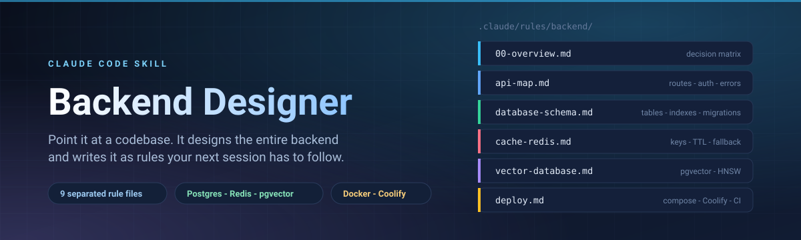
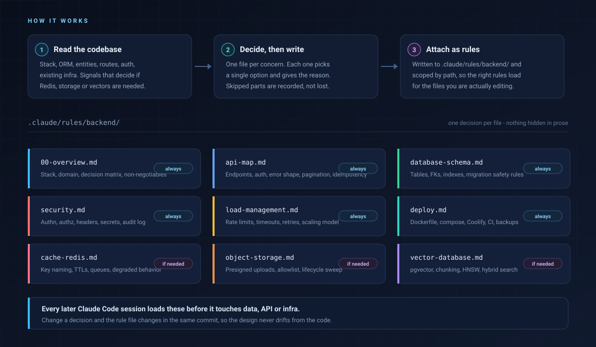
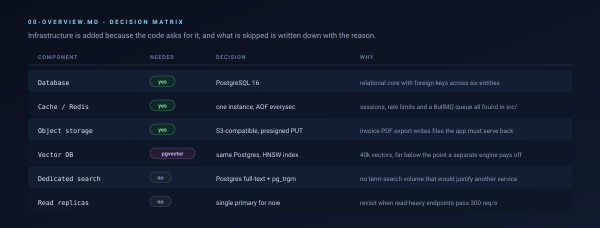

<div align="center">



<p>


</p>

**Point Claude Code at an application. Get the entire backend designed,<br>and written into the repo as rules every later session has to follow.**

</div>

---

## The problem this solves

Claude Code writes good code. What it does not do by default is remember *why* your backend looks the way it does.

So the schema grows a column at a time with no index plan. Caching appears in one endpoint and nowhere else. Rate limits get invented per route. The deploy story is a guess that changes between sessions. All the real architectural decisions live in a chat log that the next session never sees.

This skill moves those decisions into the repo, where they load automatically and can be checked against every diff.

## What it does

It reads your actual code, decides each backend concern once, and writes the result as one focused rule file per concern into `.claude/rules/backend/`. Claude Code loads those files on its own, so the next session builds against the same architecture instead of reinventing it.

<div align="center">

</div>

## Install

### Option 1: as a plugin (recommended, gets updates)

In a Claude Code session:

```
/plugin marketplace add Farivarz/Bakcend-Designer2027
/plugin install backend-designer@farivarz-skills
```

Or from your terminal:

```bash
claude plugin marketplace add Farivarz/Bakcend-Designer2027
claude plugin install backend-designer@farivarz-skills
```

On Claude Code 2.1.275 or newer, one line does both:

```
/plugin install backend-designer --marketplace Farivarz/Bakcend-Designer2027
```

### Option 2: as a plain skill folder

macOS and Linux:

```bash
git clone --depth 1 https://github.com/Farivarz/Bakcend-Designer2027 /tmp/backend-designer
cp -r /tmp/backend-designer/skills/backend-designer ~/.claude/skills/
```

Windows PowerShell:

```powershell
git clone --depth 1 https://github.com/Farivarz/Bakcend-Designer2027 $env:TEMP\backend-designer
Copy-Item -Recurse "$env:TEMP\backend-designer\skills\backend-designer" "$env:USERPROFILE\.claude\skills\"
```

Put it in `<your-project>/.claude/skills/` instead if you only want it for one repo. Restart the session and it is available.

## Use it

Open the repo you want designed and just ask. The skill triggers on its own:

```
design the backend and database for this app
```

```
I have a Next.js app with Prisma, users upload PDFs and search them
semantically. Plan the whole infrastructure and deploy it on Coolify.
```

```
design just the postgres schema for this django project
```

Or call it by name with `/backend-designer`.

That last example matters. Asking for one piece still produces the overview file, because a schema depends on what gets cached, stored and searched. The rest is recorded in the decision matrix and offered to you.

## What you get

| File | Holds | Written |
|---|---|---|
| `00-overview.md` | Stack as found, domain summary, decision matrix, non-negotiables, env var names | always |
| `api-map.md` | Resource map, auth and roles, error shape, pagination, idempotency, validation | always |
| `database-schema.md` | Every table and column, FK delete rules, index policy, safe migration rules | always |
| `security.md` | Authn and authz, secrets, headers, abuse controls, audit log, incident basics | always |
| `load-management.md` | Rate limits, body caps, timeouts, retries, background work, scaling, SLOs | always |
| `deploy.md` | Dockerfile shape, compose for local and prod, Coolify setup, CI/CD, backups | always |
| `cache-redis.md` | Key naming, TTL per use, invalidation triggers, behavior when Redis is down | if needed |
| `object-storage.md` | Presigned upload flow, type and size allowlist, orphan sweep, download auth | if needed |
| `vector-database.md` | Embedding model, chunking, HNSW parameters, tenant-safe filtering, hybrid search | if needed |

Each file is a set of decisions and constraints, not an essay. A reviewer can check a diff against it.

## It decides, and it is willing to say no

Most infrastructure advice adds services. This skill adds a component only when something in your code asks for it, and it writes down what it skipped so nobody adds it later by accident.

<div align="center">

</div>

## Defaults it starts from

| Concern | Default | Changed when |
|---|---|---|
| Database | PostgreSQL 16 | the repo already commits to another engine |
| Vectors | `pgvector` in the same Postgres | past roughly 5 to 10M vectors, or strict low latency at high QPS |
| Cache and queue | one Redis with AOF, or a Postgres `SKIP LOCKED` queue | no concrete use found, in which case neither is added |
| Object storage | S3 compatible, MinIO locally, presigned direct upload | there is no file handling in the code |
| Deploy | Docker Compose, multi-stage image, non-root user | you use Coolify, which gets its own section |
| Secrets | environment only, every name listed in the overview | never |

The reasoning is written next to each decision, so you can disagree with it on the spot.

## How the rules stay true over time

Three small things keep this from rotting into stale documentation.

1. **Path scoping.** Each file carries `paths:` frontmatter, so schema rules load when you touch migrations and deploy rules load when you touch the Dockerfile. The always-loaded cost stays small.
2. **A pointer in `CLAUDE.md`.** One line tells every session to read the overview before changing data, API or infra, and to update the matching rule file in the same change.
3. **A changelog line per file.** When a decision changes, the file records it, so you can see what moved and why.

## Repo layout

```
Bakcend-Designer2027/
├── .claude-plugin/
│   ├── plugin.json              # plugin manifest
│   └── marketplace.json         # lets this repo be added as a marketplace
├── skills/
│   └── backend-designer/
│       ├── SKILL.md             # the workflow Claude follows
│       ├── references/          # one template per output file
│       │   ├── overview.md
│       │   ├── api-map.md
│       │   ├── database-schema.md
│       │   ├── security.md
│       │   ├── cache-redis.md
│       │   ├── load-management.md
│       │   ├── object-storage.md
│       │   ├── vector-database.md
│       │   └── deploy.md
│       └── evals/               # test cases with graders
├── assets/                      # README graphics
├── CHANGELOG.md
└── LICENSE
```

The skill uses progressive disclosure. `SKILL.md` stays short, and a reference template is read only when that file is actually being written.

## Testing

Two eval cases ship with the skill. One is a full Express and Prisma SaaS design on Coolify. The other is a Django request for the schema alone, which has to skip the components the project does not need.

```bash
claude plugin validate --strict .
```

If you have the eval runner available:

```bash
claude plugin eval skills/backend-designer/evals
```

## Contributing

Issues and pull requests are welcome. The most useful contributions are reference templates for stacks the defaults do not fit well, and eval cases that catch a bad design decision.

Keep a new template in the house style: decisions with a stated reason, security and failure behavior in the same file, and constraints a reviewer can verify.

## License

MIT, see [LICENSE](LICENSE).

<div align="center">
<sub>Built for <a href="https://claude.com/claude-code">Claude Code</a>.</sub>
</div>
